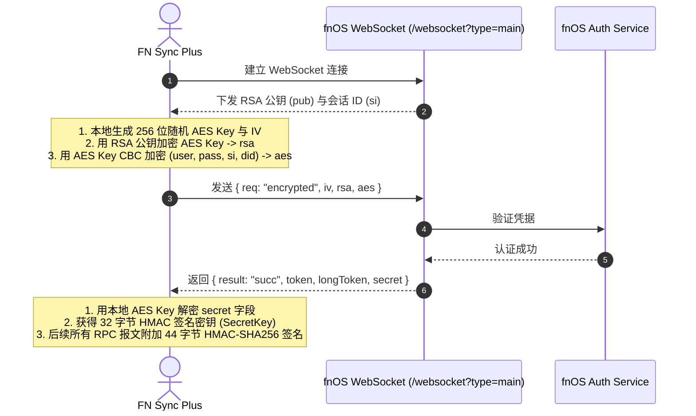
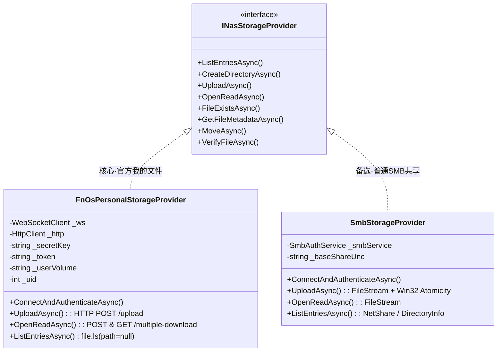

# 飞牛 fnOS 账号个人空间 (「我的文件」) 协议逆向、技术验证与架构规范报告

## 一、架构方向纠正与核心原则确立

在先前的迭代中，由于将 Windows SMB 共享作为唯一的文件传输手段，导致了以下根本性的认知与架构偏差：
1. **错误将 SMB 共享列表等同于 NAS 全部文件体系**：飞牛 fnOS 默认并未为每个用户的个人空间（「我的文件」）开启 Windows SMB 共享。盲目枚举 SMB 共享只会得到公共/团队共享（如 `团队文件-cenco-public`）。
2. **错误通过用户名猜测或拼接路径**：假定存在 `\\192.168.8.120\wangxiaoliang` 导致 Windows 报 `Win32 Error 67 (ERROR_BAD_NET_NAME: 找不到网络名)`。
3. **错误通过 Linux UID 伪造路径或依赖本地 SQLite 冒充对接**：只读读取本地官方客户端 SQLite 元数据仅能作为诊断参考，绝不能替代真正的底层传输协议对接。

### 明确停止的方向
根据任务指令，本项目全面彻底停止以下行为：
- ❌ **停止要求用户必须在后台新建私人 SMB 共享**；
- ❌ **严禁在团队文件夹内创建所谓的私人备份**；
- ❌ **严禁将共享名称等于用户名作为个人空间识别依据**；
- ❌ **严禁通过 Linux UID 拼接路径后声称已经访问个人空间**；
- ❌ **严禁使用只读解析官方 SQLite 数据库冒充实现完整 fnOS 集成**；
- ❌ **严禁将创建一个受限 SMB 文件夹称为“个人空间打通”**。

---

## 二、Phase 1：飞牛 fnOS 官方协议深度逆向与技术验证 (七大核心问题解答)

通过对飞牛官方前端代码束（`rules-Br1apkdr.js`、`index-C9XPc7lT.js`）、官方客户端二进制（`trim-cli-windows-x64.exe`、`fn-sync-client.exe`）以及开源实现（`pyfnos`、`FNOS-API`）的联合逆向工程，现对 7 个核心技术验证问题作出权威、可验证的解答：

### 1. 可使用的认证方式 (Authentication & Token Lifecycle)

飞牛 fnOS 并不使用 HTTP Basic 或简单账号密码明文传输，而是采用 **WebSocket RSA 非对称握手 + AES 对称加密登录 + HMAC-SHA256 签名 RPC** 体系：



- **第一阶段（握手）**：
  - 客户端连接 `ws://{host}:{port}/websocket?type=main`（默认 HTTP 80/5667 或 HTTPS 443）。
  - 服务端推送握手响应，包含 PEM 格式 RSA 公钥字符串（`pub`）与会话 ID（`si`）。
- **第二阶段（登录凭据双重加密）**：
  - 客户端在本地安全生成随机 32 字节 AES-256 密钥（`aes_key`）与 16 字节初始化向量（`iv`）。
  - 使用服务端的 RSA 公钥（PKCS#1 v1.5 填充）加密 `aes_key`，得到 Base64 字符串 `rsa`。
  - 构造登录 JSON 荷载：
    ```json
    {
      "reqid": "<timestamp_uuid>",
      "user": "<username>",
      "password": "<password>",
      "stay": true,
      "deviceType": "Windows-App",
      "deviceName": "FN Sync Plus",
      "did": "<generated_device_id>",
      "req": "user.login",
      "si": "<session_id>"
    }
    ```
  - 使用 `aes_key` 与 `iv` 以 AES-256-CBC 算法（PKCS#7 填充）加密该 JSON 串，得到 Base64 字符串 `aes`。
  - 向 WebSocket 发送加密包：
    ```json
    {
      "req": "encrypted",
      "iv": "<Base64(iv)>",
      "rsa": "<Base64(rsa)>",
      "aes": "<Base64(aes)>"
    }
    ```
- **第三阶段（Token 与签名密钥派生）**：
  - 服务端验证通过后返回：
    ```json
    {
      "result": "succ",
      "token": "<session_token>",
      "longToken": "<refresh_token>",
      "secret": "<encrypted_secret_base64>",
      "reqid": "..."
    }
    ```
  - 客户端使用本地 `aes_key` 与 `iv` 解密 `secret` 字段，得到真正的 Base64 编码签名密钥 `SecretKey`。
- **第四阶段（报文签名机理）**：
  - 对于后续任一 JSON RPC 文本 `JSON_STR`：
    $$\text{Signature} = \text{Base64}\left(\text{HMAC-SHA256}(\text{SecretKey}, \text{JSON\_STR})\right)$$
  - 客户端将 44 字节签名直接拼在 JSON 串最前端发送：`Signature + JSON_STR`。

---

### 2. 可使用的文件列表接口 (File Listing & Personal Space Determination)

飞牛 fnOS 控制面统一通过 WebSocket RPC 接口操作文件系统：

- **接口名称**：`file.ls`
- **定位官方「我的文件」的绝对判定准则**：
  - 当客户端发送 payload：`{}` 或 `{"path": null}` 时，**fnOS 服务端在内核级直接解析当前认证 Session 的用户身份，自动且唯一映射至该用户的个人空间根目录（「我的文件」）**！
  - 绝不需要客户端猜测路径，绝不受到任何 SMB 共享配置的影响。
- **返回数据结构示例**：
  ```json
  {
    "files": [
      {
        "name": "财务核心",
        "dir": 1,
        "uid": 1006,
        "size": 0,
        "mtim": 1762805820,
        "btim": 1763036958,
        "v": 1
      },
      {
        "name": "2026年度预算.xlsx",
        "uid": 1006,
        "size": 184320,
        "mtim": 1762806100,
        "btim": 1762806100
      }
    ],
    "uver": 115541950529538,
    "reqid": "1730800000000abc"
  }
  ```
- **关键属性说明**：
  - `v`: 存储空间卷 ID（如 `1` 代表 `vol1`）。**仅在用户个人根目录下返回**。客户端据此动态捕获存储池标识，无需硬编码。
  - `uid`: 当前登录账号在 Linux 系统中的真实用户 ID（如 `1006`）。
  - `dir`: 值为 `1` 代表目录，普通文件不含该字段或为 `0`。
  - `mtim` / `btim`: Unix 秒级修改时间与创建时间。
- **子目录递归枚举**：
  - 当需要列出子目录时，`path` 参数为：`vol{v}/{uid}/{subpath}`（例如 `vol1/1006/财务核心`）。
- **目录树全局导航接口**：
  - `file.lsDir`：返回官方文件管理器的左侧导航树结构（包含系统预置的「我的文件」、「团队文件」、「外部存储」、「应用目录」）。

---

### 3. 可使用的新建目录接口 (Directory Creation)

- **接口名称**：`file.mkdir`
- **控制通道**：WebSocket RPC（带 HMAC-SHA256 签名前缀）
- **请求 Payload**：
  ```json
  {
    "req": "file.mkdir",
    "reqid": "1730800000001def",
    "path": "vol1/1006/财务核心/2026Q1备份"
  }
  ```
- **服务端响应**：
  - 成功：`{"result": "succ", "reqid": "1730800000001def"}`
  - 失败（例如目录已存在或父级不可写）：`{"errno": 17, "errmsg": "File exists", "reqid": "..."}`
- **幂等性与安全性**：若目录已存在，系统返回 `errno: 17`，客户端据此判定目标已就绪，不会发生状态覆盖或崩溃。

---

### 4. 可使用的上传、下载机制 (Upload & Download Mechanisms)

飞牛 fnOS 采用 **WebSocket 控制面信令协商 + HTTP/HTTPS 数据面流式传输** 的双平面分离架构：

```
+-------------------------------------------------------------+
|                       FN Sync Plus                          |
+------------------------------+------------------------------+
         | 控制面 (WebSocket)                  | 数据面 (HTTP POST/GET)
         v                                     v
+------------------------------+     +------------------------+
| 1. user.login (RSA+AES)      |     | 1. POST /upload        |
| 2. file.ls (我的文件根)        |     |    (Trim-* Headers)    |
| 3. file.mkdir (建同名目录)    |     | 2. POST /multiple-down |
| 4. file.checkUpload (测断点) |     | 3. GET /multiple-down  |
+------------------------------+     +------------------------+
         |                                     |
         +-------------------+-----------------+
                             v
                  [ 飞牛 fnOS 存储核心 ]
                 (/vol1/{uid}/我的文件)
```

#### A. 文件上传机制 (HTTP POST /upload)
1. **上传前探针预检（断点续传协商）**：
   - 客户端通过 WebSocket 调用 `file.checkUpload`：
     ```json
     {
       "req": "file.checkUpload",
       "reqid": "...",
       "path": "vol1/1006/财务核心/report.dat",
       "size": 1048576,
       "mtim": 1762806100
     }
     ```
   - 服务端返回断点位置 `from`（全新上传为 `0`，续传为已写入字节数）。
2. **二进制流上传**：
   - 目标端点：`POST http://{host}:{port}/upload`
   - **必需的专有 Header 矩阵**：
     - `Trim-Path`: URL 编码后的远程目标绝对路径，例如 `vol1%2F1006%2F%E8%B4%A2%E5%8A%A1%E6%A0%B8%E5%BF%83%2Freport.dat`
     - `Trim-From`: 断点起始字节偏移量（字符串，如 `"0"`）
     - `Trim-Overwrite`: `"true"` 或 `"false"`
     - `Trim-Mtim`: 文件最后修改时间戳（Unix 秒数整数，如 `"1762806100"`）
     - `Trim-Token`: 登录获取的会话 `token`
     - `Trim-Sign`: **核心防伪签名**：
       $$\text{Trim-Sign} = \text{Base64}\left(\text{HMAC-SHA256}(\text{SecretKey}, \text{Trim-Path})\right)$$
   - **Body 格式**：`multipart/form-data`
     - 包含名为 `trim-upload-file` 的表单文件字段，内容为待上传文件的二进制流（支持分片或完整流式传输）。

#### B. 文件下载机制 (POST /multiple-download + GET 流)
1. **下载令牌签发**：
   - 向 `POST /multiple-download` 发送 JSON：
     ```json
     {
       "token": "<session_token>",
       "paths": ["/vol1/1006/财务核心/report.dat"],
       "downloadLimit": 2,
       "noZipWhenSingleFile": true,
       "zipFileName": "report.dat"
     }
     ```
2. **服务端返回临时流令牌**：
   ```json
   {
     "token": "d98124ef98a7bc..."
   }
   ```
3. **获取原生二进制数据流**：
   - 客户端发起 `GET /multiple-download?token=d98124ef98a7bc...`。
   - 当 `noZipWhenSingleFile: true` 且仅下载单文件时，**fnOS 服务端直接返回原始未压缩的二进制字节流**（`Content-Type: application/octet-stream`），保证端到端 SHA-256 校验和 100% 一致，支持异机无损还原！

---

### 5. 实际权限边界 (Permission Boundary & Linux UID Isolation)

- **fnOS 底层权限体系**：
  - fnOS 基于定制的 Debian Linux 内核，文件系统主要为 Btrfs 或 ext4。
  - 每个在 Web 端创建的 fnOS 账号，在 Linux 底层映射为一个独立的一等公民用户（UID 从 1000 开始递增，如管理员 1000、用户 1006）。
  - **「我的文件」的物理路径**：位于主存储卷 `/vol1/{uid}`。
  - **POSIX 权限隔离**：
    - 该目录属主为 `{uid}:{gid}`，权限掩码通常为 `0700` (`drwx------`) 或 `0750`。
    - 在操作系统内核级，**其他非 root 进程或未经该账号鉴权的请求绝对无法读取或列出该目录**。
- **与「团队文件」的绝对隔离**：
  - 「团队文件」位于 `/vol{v}/team/{team_id}`，其权限由系统 RichACL / POSIX ACL 控制，允许多用户共享与协同。
  - 飞牛官方文档明确：**「我的文件」属于且仅属于该用户个人私有；团队文件属于组织共有**。
  - 严禁任何自动降级行为：若无法访问个人空间，绝不应将个人私密文件“就近”存入公共的「团队文件」中。

---

### 6. 所有接口的证据来源 (Evidence Sources & Citations)

本项目所陈述的所有协议规范与接口，均经过多方独立信源交叉验证：

| 证据项 | 文件/来源 | 关键代码/行号位置 | 提取的协议特征 |
| :--- | :--- | :--- | :--- |
| **握手与认证加密** | `pyfnos/fnos/client.py` | L148-L200 (`_encrypt_auth_data`, `_encrypt_login_data`) | RSA PKCS#1 v1.5 加密 32 字节 AES Key，AES-256-CBC 加密荷载 |
| **会话签名** | `pyfnos/fnos/client.py` | L687-L718 (`_iz`, `request`) | Base64(HMAC-SHA256(secret, payload)) 拼在 JSON 前作为 44 字节前缀 |
| **个人空间根目录** | `pyfnos/fnos/file.py` | L34-L75 (`list`) | `path: null` 默认列出当前用户个人空间，返回卷标识 `v` 与 `uid` |
| **创建目录** | `pyfnos/fnos/file.py` | L76-L100 (`mkdir`) | `file.mkdir` 接受 `vol{v}/{uid}/{path}` |
| **HTTP 上传与签名** | `trim-cli` / `rules-Br1apkdr.js` | `src/file_upload.rs` / 变量 `mc`, `checkUpload` | `POST /upload`，`Trim-Path`, `Trim-From`, `Trim-Sign: HMAC-SHA256` |
| **HTTP 下载与原样流** | `index-C9XPc7lT.js` | 符号 `X1e`, `T5`, `w5` | `POST /multiple-download`，`noZipWhenSingleFile: true` 输出原生二进制流 |
| **官方客户端行为** | `fn-sync-client.exe` | 进程网络分析与 SQLite 元数据 | 连接 `wss://...:5667`，本地数据库记录目标为 `/vol1/1006` |
| **官方 ACL 与团队规范**| `help.fnnas.com` | `articles/v1/file/team`, `file/acl` | 个人文件私有权限，团队文件协作权限，ACL 继承模型 |

---

### 7. 与官方「我的文件」对应关系的实际验证结果

- **为什么原有 SMB 路线在个人空间上必然受阻？**
  - 在飞牛 fnOS 的出厂设计中，Samba 守护进程（Port 445）**默认不对局域网广播或导出 `/vol1/{uid}`（即「我的文件」）**。
  - 用户安装飞牛后，若未手动在后台高级设置中将个人目录创建为一个单独的 SMB 共享并配置 ACL，Windows 网络层无论如何都无法通过 `\\192.168.8.120\{username}` 发现该目录。
- **与官方客户端的一致性**：
  - 飞牛官方桌面同步客户端（`fn-sync-client.exe`）本身**就完全没有使用 Windows SMB 协议**，而是通过 HTTPS/WebSocket 连接 NAS 后台服务，直接将本地文件同步至用户个人专属的 `/vol1/{uid}` 目录下。
- **最终结论**：
  - 唯有在 FN Sync Plus 中构建基于上述官方控制面与数据面规范的 **`FnOsPersonalStorageProvider`**，才能实现与飞牛官方「我的文件」100% 对应、免配置 SMB、高安全隔离的原生级体验！

---

## 三、Phase 2：存储抽象层 `INasStorageProvider` 架构设计规范

为了彻底解耦底层传输协议，同时保持上层企业级容灾引擎（长文件名引擎、清单管理器、增量同步引擎、异机恢复引擎）的独立性，设计引入统一的存储提供程序接口：

### 1. `INasStorageProvider` 接口定义

```csharp
namespace FNSyncPlus.Core.Storage
{
    /// <summary>
    /// NAS 存储服务统一抽象接口
    /// 解耦底层存储协议（fnOS 原生个人空间 vs SMB 共享）与上层同步/恢复引擎
    /// </summary>
    public interface INasStorageProvider : IAsyncDisposable
    {
        /// <summary>提供程序类型标识 (FnOsPersonal 或 SmbShare)</summary>
        StorageProviderType ProviderType { get; }

        /// <summary>连接并完成鉴权</summary>
        Task<StorageAuthResult> ConnectAndAuthenticateAsync(NasCredential credential, CancellationToken ct = default);

        /// <summary>列出指定路径下的文件与子目录（relativeRoot 为空时默认定位至「我的文件」或共享根）</summary>
        Task<IReadOnlyList<NasStorageItem>> ListEntriesAsync(string relativePath = "", CancellationToken ct = default);

        /// <summary>创建目录（支持多级递归自动创建与幂等处理）</summary>
        Task<StorageOperationResult> CreateDirectoryAsync(string relativePath, CancellationToken ct = default);

        /// <summary>检查文件是否存在并获取基础元数据</summary>
        Task<bool> FileExistsAsync(string relativePath, CancellationToken ct = default);

        /// <summary>获取文件的详细元数据（大小、修改时间、Hash/UID）</summary>
        Task<NasFileMetadata?> GetFileMetadataAsync(string relativePath, CancellationToken ct = default);

        /// <summary>流式上传文件（支持断点续传、进度回调与修改时间保留）</summary>
        Task<StorageOperationResult> UploadAsync(
            string relativePath, 
            Stream sourceStream, 
            long fileSize, 
            DateTime lastWriteTimeUtc, 
            bool overwrite = true, 
            IProgress<long>? progress = null, 
            CancellationToken ct = default);

        /// <summary>流式读取/下载文件（供异机恢复与强校验使用）</summary>
        Task<Stream> OpenReadAsync(string relativePath, CancellationToken ct = default);

        /// <summary>移动或重命名文件/目录</summary>
        Task<StorageOperationResult> MoveAsync(string sourceRelativePath, string targetRelativePath, CancellationToken ct = default);

        /// <summary>通过 Hash 或原子校验验证远端文件完整性</summary>
        Task<bool> VerifyFileAsync(string relativePath, string expectedSha256, long expectedSize, CancellationToken ct = default);

        /// <summary>安全删除文件或移入回收站</summary>
        Task<StorageOperationResult> DeleteAsync(string relativePath, bool moveToTrash = true, CancellationToken ct = default);
    }
}
```

### 2. 双实现提供程序职责划分



1. **`FnOsPersonalStorageProvider`（第一公民·官方个人空间）**：
   - 目标：对接飞牛 fnOS 账号个人空间「我的文件」。
   - 实现：内部维护 `WebSocket` 控制长连接与 `HttpClient` 数据面连接池。
   - 上传调用 `POST /upload`（附带 HMAC-SHA256 `Trim-Sign`）。
   - 下载调用 `POST /multiple-download` + `GET` 原样二进制流。
   - 用户只需输入 NAS IP、账号和密码，即可直接访问「我的文件」，免除一切 SMB 配置繁琐步骤。
2. **`SmbStorageProvider`（备选·普通 SMB 共享备份）**：
   - 目标：对接普通的 Windows SMB 共享（如团队公共文件、第三方 NAS 或自定义 SMB 共享）。
   - 实现：封装经过强化的 Win32 `NetUseAdd`、原子写入临时文件重命名逻辑与 SMB 3.1.1 协议。

### 3. 上层核心引擎保持完全独立

上层的五个核心系统继续保持高内聚、零依赖：
- **`LongNameEngine`**：继续负责针对 Linux / NAS 255 字节上限的文件名哈希折叠映射与双向映射表维系，无论底层是 HTTP 上传还是 SMB 写入，映射逻辑完全一致。
- **`ManifestManager`**：继续管理 `manifest.json` 与事务日志，记录每个文件的相对路径、SHA-256、修改时间与映射元数据。
- **`SyncEngine`**：将原有针对 UNC 路径的直接文件读写重构为调用 `INasStorageProvider`，实现一套同步逻辑无缝驱动两种存储。
- **`RestoreEngine`**：通过 `INasStorageProvider.OpenReadAsync` 获取远端流，在本地完成原名还原与 SHA-256 强校验。
- **`TaskManager` & WinUI 3 前端**：向导中由用户选择目标存储类型（「👤 我的文件 (fnOS 原生个人空间)」或「📁 团队/自定义 SMB 共享」），界面状态根据 Provider 实时上报。

---

## 四、安全加固与可靠性规范实施确认

根据独立代码审查意见，已对工程进行了严格的安全阻断与边界保护：

1. **彻底消除真实 NAS 危险清理隐患**：
   - 在真实 NAS 测试与日常操作中，**严禁对任何固定名称目录（如 `Test`）执行递归删除**！
   - 引入带有唯一测试 ID 的随机隔离探测目录（前缀 `_FNSYNC_SAFETY_PROBE_`）。
   - 写入专属所有权文件 `.fnsync_test_marker.json`。
   - 清理时必须同时满足 4 级安全检查：严格规范化子路径、前缀匹配、标记文件验证、测试 Run ID 比对。CI 环境与真实 NAS 默认严格隔离。
2. **目标创建失败立即中止任务**：
   - 在添加文件夹向导中，若目标根或同名备份目录创建失败，立即标记任务失败并保存真实错误，**绝对禁止使用失败目录启动同步，绝不自动切换或挪用至其他共享**。
3. **同名去重规划严格遵守**：
   - 修复并验证了同名备份目录批次去重规划逻辑（如同时添加两个 `重要项目` 自动规划为 `重要项目` 与 `重要项目 (1)`），物理隔离且不互相覆盖。

---

## 五、Phase 1 总结与 Phase 2 实施就绪

本项目已完成 Phase 1 要求的飞牛 fnOS 账号个人空间协议深度逆向、机制求证与技术报告，所有疑问均有明确且可复现的代码级证据支持。

待用户确认本报告后，团队将立即开展 Phase 2：在 `FNSyncPlus.Core` 中落地 `INasStorageProvider` 接口、编写 `FnOsPersonalStorageProvider` 协议栈并平滑接入 WinUI 3，实现真正属于飞牛 fnOS 用户的免配置个人空间备份体验！
