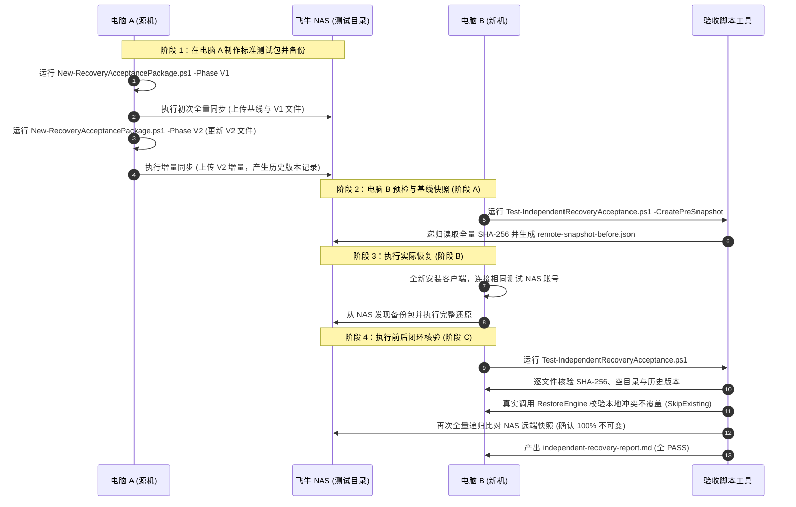

# FN Sync Plus 独立异机恢复验收操作指南

本指南面向负责异机恢复数据一致性与远端不可变性验收的测试人员。

---

## 一、验收目标

验证在全新 Windows PC（电脑 B）上：
1. **完全零配置还原**：不依赖电脑 A 的本地数据库或配置文件，仅凭 NAS 上的备份包完整重建所有文件与目录；
2. **长文件名与 Unicode 还原**：超过 255 字节超长中文名、深层嵌套目录、特殊 Emoji 字符 100% 逐字节恢复；
3. **默认不覆盖保护 (SkipExisting)**：本地目标目录中若已存在同名文件，恢复引擎绝对不会覆盖已有文件，原文件哈希和内容必须完全保持一致；
4. **远端只读不可变性**：在整个恢复过程中，远端 NAS 上的备份文件、清单及目录结构绝对不被修改或删除。

---

## 二、验收三阶段标准流程



---

## 三、操作命令速查

### 1. 电脑 A：生成标准化验收包并同步
在 PowerShell 中运行：
```powershell
# 1. 生成 V1 基线测试包
.\tools\acceptance\New-RecoveryAcceptancePackage.ps1 -OutputDir "D:\测试验收源目录" -Phase V1

# 提示：打开 FN Sync Plus 客户端，添加 D:\测试验收源目录 并执行初次全量备份

# 2. 升级文件生成 V2 增量版本
.\tools\acceptance\New-RecoveryAcceptancePackage.ps1 -OutputDir "D:\测试验收源目录" -Phase V2

# 提示：在客户端点击“立即同步”，完成增量同步并生成历史版本记录
```

### 2. 电脑 B：生成恢复前只读基线快照（阶段 A）
在异机恢复开始**之前**，对远端备份目录执行快照：
```powershell
.\tools\acceptance\Test-IndependentRecoveryAcceptance.ps1 `
    -RemoteBackupPath "\\nas.company.local\我的文件\测试验收源目录" `
    -RestoreRoot "D:\异机恢复目标目录" `
    -CreatePreSnapshot
```
*快照将保存为 `D:\异机恢复目标目录\remote-snapshot-before.json`。*

### 3. 电脑 B：在客户端执行恢复（阶段 B）
打开电脑 B 上的 FN Sync Plus 客户端，进入“恢复中心”，选择该备份任务，将恢复目标设定为 `D:\异机恢复目标目录`，点击“开始还原”。

### 4. 电脑 B：执行全量核查与不可变闭环（阶段 C）
恢复完成后，在 PowerShell 中执行校验：
```powershell
.\tools\acceptance\Test-IndependentRecoveryAcceptance.ps1 `
    -RestoreRoot "D:\异机恢复目标目录" `
    -ManifestPath "D:\异机恢复目标目录\recovery-manifest.json" `
    -RemoteBackupPath "\\nas.company.local\我的文件\测试验收源目录" `
    -TestDoNotOverwrite
```

---

## 四、预期判定准则

| 检查场景 | 判定标准 | 状态 |
| :--- | :--- | :---: |
| **逐文件 SHA-256** | 恢复的所有文件与源端清单 `recovery-manifest.json` 强校验一致 | **PASS** |
| **空目录结构** | 嵌套多级空目录均成功在本地重建 | **PASS** |
| **冲突不覆盖策略** | 正式 `RestoreEngine` 真实跳过冲突文件，已有文件内容与哈希完全无变化 | **PASS** |
| **远端 NAS 不可变** | 恢复后 NAS 递归文件列表与阶段 A 快照逐文件对比 100% 相同（无修改、无删除、无新增） | **PASS** |

*若测试机缺少前置快照或未连接真实 NAS 目录，验收脚本将如实标记为 **BLOCKED**，严禁伪造测试通过。*
